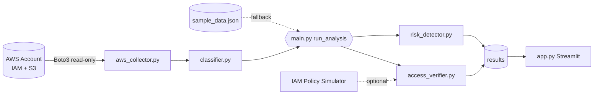

# AWS Identity-Centric Risk Analysis and Verification Framework

Python + Boto3 + Streamlit tool that inventories AWS IAM identities, classifies them as human / non-human,
detects risky permissions and trust relationships (IAM + S3), verifies selected identity→resource access paths
(optionally with the IAM Policy Simulator) and presents everything in an interactive dashboard.

## Architecture



## Workflow
1. **Collect** IAM users, roles, policies, trust policies and S3 buckets (`collect_aws_data`).
2. **Classify** each identity as `human` / `non-human` with a recorded reason (`classify_identities`).
3. **Map** policies and trust relationships (`policy_utils.py`).
4. **Detect** risks → findings with severity, reason, resource, remediation (`detect_risks`).
5. **Verify** access paths: can *principal* assume *role*, and may the role perform *action* on *resource*? (`verify_access`)
6. **Display** in the dashboard: Overview, Inventory, Findings, Verification, Recommendations.

## Setup
```bash
git clone <repo> && cd aws-identity-risk-analyzer
python -m venv .venv && source .venv/bin/activate      # Windows: .venv\Scripts\activate
pip install -r requirements.txt
```

### AWS credentials (never commit them)
Use a dedicated **read-only** identity in a **test** account, configured via `aws configure --profile risk-analyzer`
or environment variables. Minimum permissions:
```json
{"Version":"2012-10-17","Statement":[{"Effect":"Allow","Action":[
 "iam:Get*","iam:List*","iam:SimulatePrincipalPolicy",
 "s3:ListAllMyBuckets","s3:GetBucketPolicy","s3:GetBucketPublicAccessBlock"],"Resource":"*"}]}
```

## Run
```bash
streamlit run app.py              # dashboard (starts in sample-data mode)
python main.py --sample           # CLI summary, offline
python main.py --profile risk-analyzer --simulator   # CLI against AWS
python -m pytest                  # tests
```
In the sidebar untick **Use sample data**, enter your profile name and press **Run analysis**.
If AWS is unreachable the app shows a warning and falls back to sample data.

## Shared data schema
```jsonc
identity: {name, arn, kind: "user"|"role", type: "human"|"non-human", classification_reason,
           policies: [{name, type, document}], trust_policy, mfa_enabled, has_console_access,
           access_key_count, last_used}
resource: {name, type: "s3", arn, policy, public_access_block}
finding:  {id, identity, identity_arn, severity: critical|high|medium|low, title, reason, resource, remediation}
verification: {status: allowed|blocked|inconclusive, principal, role, role_arn, resource, action, evidence: []}
```
`verify_access(identity, principal, resource, action="s3:GetObject", use_simulator=False, session=None)` -
the extra `action` parameter lets the dashboard show the tested action (a 3-argument version still works).

## Project structure
```
app.py  main.py  requirements.txt  README.md
collector/{aws_collector,classifier}.py
analyzer/{risk_detector,access_verifier,policy_utils}.py
data/sample_data.json   tests/   docs/{architecture.mmd,DEMO_SCRIPT.md}
```

## Risk rules
| Rule | Severity |
|---|---|
| `*` on `*`; public bucket policy; trust principal `*` | critical |
| Service wildcard on `*` (e.g. `s3:*`); privilege-escalation actions on `*`; cross-account root trust w/o condition; console user w/o MFA | high |
| Service wildcard on specific resource; S3 actions on `*`; Block Public Access off | medium |
| Identity unused > 90 days | low |

## Limitations
IAM + S3 only. Offline verifier evaluates Allow/Deny, wildcards and trust principals; `Condition` blocks are reported as
**inconclusive**; SCPs, permission boundaries, session policies, ACLs and KMS are not evaluated. Classification is heuristic.
Pagination of per-identity policy lists is limited to the first 100 items.
